# GateKeep: Organised Plan to Fix Every Problem

This is the step-by-step plan to fix all the problems listed in `drawback.md`.

It has four parts:

1. **All problems in one list**, each with a short ID, size, and what it depends on
2. **Dependency map**, showing which fix must happen before which
3. **Priority plan**, split into 7 milestones, in the order you should do them
4. **Rules to follow while fixing**, so the work stays clean

Every item points back to its problem number in `drawback.md` (for example "see 1.5"), so you can read the simple explanation there.

---

## How to read this document

**IDs.** Each problem has a short ID. The letter tells you the area:

| Letter | Area |
|---|---|
| **A** | Access and login |
| **B** | The three checkpoints (phase state machine) |
| **C** | Test results you can trust |
| **D** | Workspace safety and secrets |
| **E** | The diary (audit log) |
| **F** | The dashboard (what the reviewer sees) |
| **G** | Code cleanup and architecture |
| **H** | Documentation and README |
| **I** | New features that make GateKeep better than other tools |
| **T** | Testing setup |

**Size.**

| Size | Rough time for one person |
|---|---|
| **S** (small) | Less than half a day |
| **M** (medium) | 1 to 2 days |
| **L** (large) | 3 to 5 days |

**Depends on.** You must finish those items first. "None" means you can start it today.

**Blocks.** Items that cannot start until this one is done.

---

# Part 1: All Problems With Their Dependencies

## A. Access and login

| ID | Problem | drawback.md | Size | Depends on | Blocks |
|---|---|---|---|---|---|
| A1 | Add login. Humans sign in. The robot gets its own separate token that can never approve. | 1.1 | L | G4 | A2, A4, B1, D7, E2, I4 |
| A2 | Reviewer name and role come from the login, not from a dropdown. | 1.2 | M | A1 | F9, E2, I4 |
| A3 | Allow only the dashboard's address (fix CORS `*`). | 1.3 | S | None | None |
| A4 | WebSocket (live updates) needs login and an origin check. Stop anyone from sending fake live events. | backend review | M | A1 | None |

## B. The three checkpoints (phase state machine)

| ID | Problem | drawback.md | Size | Depends on | Blocks |
|---|---|---|---|---|---|
| B0 | Quick fix: if no step is active, **deny** everything instead of guessing "Requirements". | 2.3 | S | None | None |
| B1 | Close the back doors. Only "decide" can change steps. Robot endpoints can only submit work, not set states. | 2.1 | M | A1, B2 | None |
| B2 | Build one real state machine in the backend: a fixed list of allowed moves, checked on the server. | 2.1, 2.3 | L | G4, E6 | B1, B3, B4, B5, B8, G9, I2 |
| B3 | Add a real Gate 3 step with a human role. "Request review" moves the run to Gate 3. | 2.2 | M | B2 | B6, B7, F4, F5 |
| B4 | Rework loop. Reject sends the run back to the right step (Gate 2 reject goes to Design). | 2.3 | M | B2 | F6 |
| B5 | Only gate steps can be approved by humans. Robot steps cannot be "approved" to skip them. | 2.1 | S | B2 | None |
| B6 | Freeze the workspace when review is requested. No writes after that. | 2.4 | M | B3 | B7 |
| B7 | Approval is tied to an exact code fingerprint (diff hash) and an exact test run ID. | 2.4 | M | B3, B6, C2 | I6 |
| B8 | Approve, retry and start must be safe to repeat. Pressing twice must not skip a gate. | backend review | S | B2 | None |

## C. Test results you can trust

| ID | Problem | drawback.md | Size | Depends on | Blocks |
|---|---|---|---|---|---|
| C1 | "Passed" only when exit code is 0, no timeout, and at least 1 test ran. Handle Docker missing. | 3.1 | S | None | C2 |
| C2 | Read results from a JUnit XML file, not by searching printed text. Save each test name and result. | 3.2 | M | C1 | B7, C3, I3 |
| C3 | Always run the project's existing tests too. Mark which tests are new. Do not let the robot pick any target freely. | 3.3 | M | C2 | None |
| C4 | Kill the container on timeout. Add `--cap-drop ALL`, swap limit, tmpfs size limit. | 3.4 | S | None | None |

## D. Workspace safety and secrets

| ID | Problem | drawback.md | Size | Depends on | Blocks |
|---|---|---|---|---|---|
| D1 | Block any path containing `.git`. Run git with "no external programs" options. | 1.5 | S | None | None |
| D2 | Check the **real** file behind a shortcut (symlink), or refuse shortcuts. Also in search and context tools. | 1.7 | M | D5 | None |
| D3 | Hide secrets in **every** text that leaves GateKeep: test output, diff, search, file reads. Hide full private keys. | 1.6, 1.10 | M | D5 | D8 |
| D4 | Do not save the GitHub token in `.git/config`. Remove it from error messages. | 1.8 | S | None | None |
| D5 | One single secret-file block list, with the missing names added and whole folders blocked. | 1.9 | S | None | D2, D3, D8, I5 |
| D6 | Run IDs may only contain letters, numbers, `-` and `_`. Folder must stay inside `workspaces/`. | 1.11 | S | None | None |
| D7 | MCP server listens only on `127.0.0.1` by default (bind, S) and requires a token (token, M). | 1.4 | S + M | A1 (token part only) | None |
| D8 | Remove secret files from the copy of the project before tests run in Docker. | 1.6 | M | D3, D5 | None |

## E. The diary (audit log)

| ID | Problem | drawback.md | Size | Depends on | Blocks |
|---|---|---|---|---|---|
| E1 | Switch from plain SHA-256 to HMAC with a secret key kept outside the database. | 4.1 | M | E4 | I6 |
| E2 | Only the server writes diary entries. Name from login, time from server clock. Close the open "add entry" endpoint. | 4.2 | M | A1, A2 | None |
| E3 | Turn the tamper endpoint off unless demo mode is on. | 4.3 | S | None | None |
| E4 | Add run ID into each stamp. Store the latest stamp separately so deleted entries are detected. (Do together with E1, both change the stamp format.) | 4.4 | M | None | E1 |
| E5 | Check that event, actor and dates are text before saving. Block `__proto__` keys. | 4.5 | S | None | None |
| E6 | Use database transactions and locks for approvals and diary writes. | 4.6 | M | T0 | B2 |
| E7 | Record blocked actions. If the diary write fails, cancel the action. | 4.7 | S | None | None |

## F. The dashboard

| ID | Problem | drawback.md | Size | Depends on | Blocks |
|---|---|---|---|---|---|
| F1 | Remove all "demo mode" fake successes. Show a real error banner. | 5.1 | S | None | G2 |
| F2 | Remove hardcoded test numbers. Show "No test run yet". Red when failed. | 5.2 | S | None | G2 |
| F3 | Remove fake source code, the hardcoded "Line 42" rework message, and "a comment rejects the gate" behaviour. | 5.3 | S | None | G2 |
| F4 | One clear gate banner on every page: which gate, who must act, Approve and Request changes buttons. Also (found in the Milestone 2 browser check): disable Approve when the server would refuse it (role does not match the gate, or the requester at Gate 3), and show the right time on a step sent back for rework. | 5.5 | M | B3 | None |
| F5 | Gate 3 three-column page: requirements with tests, code changes, design with "planned vs changed files". | 5.4 | L | B3, G2, I2, I3 | None |
| F6 | Rework window lets the reviewer choose the step to send work back to. Only that step's comments are sent. | 5.6 | M | B4 | None |
| F7 | Accessibility: dialogs, Esc key, labels, keyboard-reachable comment buttons, allow text selection. | 5.7 | M | G2 | None |
| F8 | Live updates: reconnect with backoff, reload once after reconnect, debounce refresh. | 5.7 | S | None | None |
| F9 | Remove the "Acting as" dropdown. Use the logged-in role. | 1.2 | S | A2 | None |

## G. Code cleanup and architecture

| ID | Problem | drawback.md | Size | Depends on | Blocks |
|---|---|---|---|---|---|
| G1 | Delete about 700 lines of unused dashboard code, `mcp_schema.sql`, and other dead code. | 6.1 | S | None | G2 |
| G2 | Split `CodeReview.jsx`, `SpecsDesignView.jsx` and `App.jsx` into smaller files. | 6.2 | M | F1, F2, F3, G1 | F5, F7 |
| G3 | Remove duplicates: one diff parser, one workspaces path, one block list (together with D5). | 6.3 | S | None | None |
| G4 | **Decision:** the Node backend is the only owner of run state. Python only does work and reports. Write it down in a short decision record. | 6.4 | S | None | A1, B2, G9 |
| G5 | Python server: use logging to stderr, not `print()` (fixes broken stdio messages). | 6.5 | S | None | None |
| G6 | Python server: stop slow network and Docker calls from freezing the server (async or threads). | 6.5 | M | None | None |
| G7 | Fix `apply_patch`: keep file encoding and line endings, refuse empty search text. | 6.5 | S | None | None |
| G8 | Robot sessions: expire them, stop auto-attaching to a random run on startup. | 6.5 | S | None | None |
| G9 | Pipeline mode: decide keep or remove. If kept: follow the same state machine and policy, keep the AI's real design, add `chat()` for Claude, make self-heal real, save progress to the database instead of memory. | 2.7, 2.8 | L | G4, B2 | None |

## H. Documentation

| ID | Problem | drawback.md | Size | Depends on | Blocks |
|---|---|---|---|---|---|
| H1 | Make the README honest **now**: "SHA-256 hash chain", real test counts, tool count, no "100%" claims. | Part 7 | S | None | None |
| H2 | Final README and guide update after all milestones, covering login, Gate 3 and the policy file. | Part 7 | S | All milestones | None |

## I. New features that make GateKeep better than other tools

| ID | Problem | drawback.md | Size | Depends on | Blocks |
|---|---|---|---|---|---|
| I1 | Ship ready-made Claude Code and Cursor settings that block their built-in Edit and Bash, so the robot must use GateKeep. | 8.1 | M | None | None |
| I2 | Structured design (list of files and interfaces). Warn or block when the robot changes files outside the plan. | 2.5 | L | B2 | F5 |
| I3 | Requirement IDs (`REQ-1`) linked to design, code changes and tests. Coverage table. | 2.6 | L | C2 | F5 |
| I4 | Team roles and "the person who asked for the work cannot approve it". | Part 8 | M | A1, A2 | None |
| I5 | `gatekeep.yaml` policy file in the project: protected paths, allowed tools, required reviewers. | Part 8 | M | D5 | None |
| I6 | Export a GitHub Pull Request with the approval history attached. GateKeep as a required check. | Part 8 | L | B7, E1 | None |

## T. Testing setup

| ID | Problem | drawback.md | Size | Depends on | Blocks |
|---|---|---|---|---|---|
| T0 | Run backend tests against a **real** Postgres (Docker) so transactions and locks can be tested. Run the 2 skipped Docker sandbox tests in CI. | backend review | M | None | E6 |
| T1 | Every fix adds a test that fails before and passes after (see Part 4). | all | ongoing | None | None |

**Total: 60 items** (A 4, B 9, C 4, D 8, E 7, F 9, G 9, H 2, I 6, T 2).

---

# Part 2: Dependency Map

## Picture

Arrows mean "must be done before". GitHub shows this block as a diagram.

```mermaid
flowchart TD
    %% Foundations
    G4[G4 Node owns state] --> A1[A1 Login and robot token]
    G4 --> B2[B2 Real state machine]
    G4 --> G9[G9 Pipeline mode decision]
    T0[T0 Real Postgres tests] --> E6[E6 Transactions]
    E6 --> B2

    %% Access
    A1 --> A2[A2 Identity from login]
    A1 --> A4[A4 WebSocket auth]
    A1 --> D7[D7 MCP token]
    A1 --> B1[B1 Close back doors]
    A1 --> E2[E2 Server-only diary writes]
    A2 --> E2
    A2 --> F9[F9 Remove role dropdown]
    A2 --> I4[I4 Separation of duties]

    %% State machine
    B2 --> B1
    B2 --> B3[B3 Real Gate 3]
    B2 --> B4[B4 Rework loop]
    B2 --> B5[B5 Only gates approvable]
    B2 --> B8[B8 Safe to repeat]
    B2 --> I2[I2 Design vs code check]
    B2 --> G9
    B3 --> B6[B6 Freeze workspace]
    B3 --> F4[F4 Gate banner]
    B3 --> B7[B7 Approve exact version]
    B6 --> B7
    B4 --> F6[F6 Rework target step]

    %% Tests
    C1[C1 Exit code check] --> C2[C2 JUnit results]
    C2 --> C3[C3 Run existing tests]
    C2 --> B7
    C2 --> I3[I3 Requirement tracking]

    %% Secrets
    D5[D5 One block list] --> D2[D2 Symlinks]
    D5 --> D3[D3 Redact everywhere]
    D5 --> D8[D8 Strip secrets before tests]
    D3 --> D8
    D5 --> I5[I5 gatekeep.yaml]

    %% Audit
    E4[E4 Run ID and head anchor] --> E1[E1 HMAC]
    E1 --> I6[I6 PR export]
    B7 --> I6

    %% Dashboard
    F1[F1 Remove demo fallbacks] --> G2[G2 Split big files]
    F2[F2 Remove fake test numbers] --> G2
    F3[F3 Remove fake code] --> G2
    G1[G1 Delete dead code] --> G2
    G2 --> F5[F5 Gate 3 three-column page]
    G2 --> F7[F7 Accessibility]
    B3 --> F5
    I2 --> F5
    I3 --> F5
```



## The critical path (the longest chain)

This chain decides how long the whole plan takes. Nothing on it should be left waiting.

```
G4 (decision)
 -> T0 (real Postgres tests)
 -> E6 (transactions)
 -> B2 (real state machine)
 -> B3 (real Gate 3)
 -> B6 (freeze workspace)
 -> B7 (approve exact version)
 -> I6 (Pull Request export)
```

A second long chain runs alongside it:

```
C1 -> C2 -> I3 (requirement tracking) -> F5 (Gate 3 three-column page)
```

## Items with no dependencies (start any time)

These can be done in any order, by anyone, right now:

A3, B0, C1, C4, D1, D4, D5, D6, D7 (bind part), E3, E4, E5, E7, F1, F2, F3, F8, G1, G3, G4, G5, G6, G7, G8, H1, I1, T0

---

# Part 3: Priority Plan (7 Milestones)

Do the milestones in order. Inside a milestone, items are listed in the best order, but most can be done in parallel.

Rough total for one person: **about 8 to 10 weeks.**

---

## Milestone 0: Stop the Damage (quick wins)

**Goal:** close the most dangerous holes and stop the product from showing false information, using only small, independent fixes.
**Time:** about 3 to 4 days.
**Why first:** every item here is small, has no dependencies, and removes a serious risk or a false claim today.

| Order | ID | What to do | Size |
|---|---|---|---|
| 1 | H1 | Make the README honest (SHA-256 not HMAC, real test counts, remove "100%" claims) | S |
| 2 | D1 | Block `.git` paths, run git with external programs turned off | S |
| 3 | C1 | "Passed" only if exit code 0, no timeout, at least 1 test | S |
| 4 | E3 | Tamper endpoint only in demo mode | S |
| 5 | B0 | No active step means deny, not "Requirements" | S |
| 6 | D6 | Validate run IDs | S |
| 7 | D4 | Remove GitHub token from `.git/config` and error messages | S |
| 8 | D7 (bind) | MCP server listens on `127.0.0.1` by default | S |
| 9 | A3 | CORS: only allow the dashboard address | S |
| 10 | F1, F2, F3 | Remove fake successes, fake test numbers, fake code and fake rework message | S each |
| 11 | E5 | Validate diary field types, block `__proto__` | S |
| 12 | E7 | Record blocked actions, cancel the action if the diary write fails | S |
| 13 | G5 | Python logging to stderr (stdio fix) | S |
| 14 | G1 | Delete dead code | S |
| 15 | C4 | Kill container on timeout, `--cap-drop ALL` | S |

**Done when:**
- The robot cannot write to `.git`.
- Docker off, or zero tests, shows "Failed" or "Sandbox unavailable", never "Passed".
- The dashboard never shows "demo mode" or hardcoded numbers.
- The README makes no claim that the code does not support.
- The tamper button is gone unless `DEMO_MODE=1`.

---

## Milestone 1: Foundations

**Goal:** make the big decisions and build the base that the real fixes need.
**Time:** about 1.5 weeks.
**Why now:** the state machine (Milestone 2) cannot be built safely without one state owner, transactions, and login.

| Order | ID | What to do | Size |
|---|---|---|---|
| 1 | G4 | Write a short decision record: "Node owns all run state. Python only does work and reports." | S |
| 2 | T0 | Backend tests run on real Postgres in Docker. Turn on the skipped sandbox tests in CI. | M |
| 3 | E6 | Approvals and diary writes inside one transaction with a row lock | M |
| 4 | A1 | Login for humans (GitHub sign-in is simplest), separate robot token with limited rights | L |
| 5 | D7 (token) | MCP server requires the robot token | M |
| 6 | A4 | WebSocket requires login and checks origin | M |
| 7 | D5 | One single block list with missing names and blocked folders | S |
| 8 | G3 | Remove duplicate diff parser and workspaces path | S |

**Done when:**
- Calling the approve endpoint without a human login returns "401 Unauthorized".
- The robot token gets "403 Forbidden" on approve.
- Two approvals sent at the same moment produce exactly one approval and one diary entry (tested on real Postgres).
- There is only one block list in the code.

---

## Milestone 2: Real Checkpoints

**Goal:** the three checkpoints are actually enforced. Nothing can skip a gate.
**Time:** about 1.5 to 2 weeks.
**Why now:** this is the core promise of GateKeep.

| Order | ID | What to do | Size |
|---|---|---|---|
| 1 | B2 | Real state machine on the server with a fixed table of allowed moves | L |
| 2 | B5 | Only gate steps can be approved by humans | S |
| 3 | B3 | Add a real Gate 3 step. "Request review" moves the run to Gate 3. | M |
| 4 | B4 | Rework loop: reject sends the run back to the correct step | M |
| 5 | B1 | Close the back doors (`PATCH /runs`, `PUT /phases`, open audit write) | M |
| 6 | B8 | Approve, start and retry are safe to repeat | S |
| 7 | A2 | Reviewer name and role from the login | M |
| 8 | E2 | Only the server writes diary entries, with login name and server time | M |
| 9 | F9 | Remove the "Acting as" dropdown | S |

**The allowed moves table for B2 (use this as the design):**

| From | Action | To | Who can do it |
|---|---|---|---|
| Requirements | submit requirements | Gate 1 | Robot |
| Gate 1 | approve | Design | Planner |
| Gate 1 | reject | Requirements | Planner |
| Design | submit design | Gate 2 | Robot |
| Gate 2 | approve | Code | Engineer |
| Gate 2 | reject | Design | Engineer |
| Code | request review | Gate 3 | Robot |
| Gate 3 | approve | Done | Engineer (not the requester) |
| Gate 3 | reject to code | Code | Engineer |
| Gate 3 | reject to design | Design | Engineer |
| Any active step | cancel | Cancelled | Planner or Engineer |
| Done or Cancelled | anything | (refused) | Nobody |

**Done when:**
- Every row in the table above has a test, and every move **not** in the table is refused.
- The "reject at Gate 2, resubmit requirements, jump to Code" bug has a test that proves it is fixed.
- A finished run cannot be reopened.
- Every step change has exactly one diary entry with the real logged-in name.

---

## Milestone 3: Trustworthy Evidence

**Goal:** test results, secrets and the diary can all be trusted.
**Time:** about 1.5 to 2 weeks.
**Why now:** with real gates in place, the next promise is "what the reviewer sees is true".

| Order | ID | What to do | Size |
|---|---|---|---|
| 1 | C2 | Read results from JUnit XML, save each test name and result | M |
| 2 | C3 | Always run existing tests too, mark new tests, restrict the target | M |
| 3 | B6 | Freeze the workspace at "request review" | M |
| 4 | B7 | Approval tied to diff hash and test run ID | M |
| 5 | D2 | Check the real file behind shortcuts, in all tools | M |
| 6 | D3 | Hide secrets in every output, including tests and diffs | M |
| 7 | D8 | Remove secret files from the copy before tests run | M |
| 8 | E4 | Run ID in each stamp, store the latest stamp separately | M |
| 9 | E1 | HMAC with a secret key outside the database | M |

**Done when:**
- A test that prints `999 passed` does not change the count.
- A test that prints `.env` shows hidden values (`***`), and `.env` is not in the sandbox at all.
- A shortcut to `.env` is refused.
- Changing code after "request review" is refused.
- If the code changed after the last test run, the approve button is disabled with a reason.
- Editing a diary row and recalculating plain SHA-256 stamps is detected (because of HMAC).
- Deleting the last diary entry is detected.

---

## Milestone 4: Clear Reviewer Experience

**Goal:** a developer who opens a run understands immediately which checkpoint it is at and what to check.
**Time:** about 1.5 weeks.
**Why now:** the backend now gives real, honest data, so the screens can show it properly.

| Order | ID | What to do | Size |
|---|---|---|---|
| 1 | G2 | Split `CodeReview.jsx`, `SpecsDesignView.jsx`, `App.jsx` | M |
| 2 | F4 | Gate banner on every page with Approve and Request changes | M |
| 3 | F6 | Rework window: choose the step, send only that step's comments | M |
| 4 | F8 | Live updates: backoff, reload after reconnect, debounce | S |
| 5 | F7 | Accessibility fixes | M |
| 6 | F5 (part 1) | Gate 3 page shows approved requirements and design next to the code (without links yet) | M |

**Done when:**
- On any page, a new reviewer can answer "which gate is this, who must act, what do I click" in 5 seconds.
- Gate 3 shows requirements, design and diff on one screen.
- No component file is longer than about 400 lines.
- All dialogs close with Esc and are reachable by keyboard.

---

## Milestone 5: Architecture Cleanup

**Goal:** fewer moving parts, no hidden traps, one consistent way of working.
**Time:** about 1.5 weeks.

| Order | ID | What to do | Size |
|---|---|---|---|
| 1 | G9 | Pipeline mode: decide keep or remove. If kept, make it follow the same state machine and policy, keep the AI's real design, add Claude `chat()`, make self-heal real, save progress in the database. | L |
| 2 | G6 | Python server: no blocking calls on the main loop | M |
| 3 | G7 | Fix `apply_patch` encoding, line endings, empty search | S |
| 4 | G8 | Session expiry, no auto-attach on startup | S |

**Recommendation for G9:** if time is short, **remove pipeline mode** and keep only MCP mode. MCP mode is the real product (outside robots connecting to GateKeep). Pipeline mode doubles the work and currently has more broken parts. You can add it back later on top of the finished state machine.

**Done when:**
- There is one way runs move through steps, and both modes (if both are kept) pass the same state machine tests.
- Restarting any service does not leave a run stuck.

---

## Milestone 6: Features That Beat Other Tools

**Goal:** turn GateKeep from "a safer wrapper" into "the team approval system for AI-written code".
**Time:** about 2 to 3 weeks.

| Order | ID | What to do | Size |
|---|---|---|---|
| 1 | I1 | Ready-made Claude Code and Cursor settings that force the robot to use only GateKeep | M |
| 2 | I2 | Structured design (files and interfaces). Warn or block changes outside the plan. | L |
| 3 | I3 | Requirement IDs linked to design, code and tests. Coverage table. | L |
| 4 | F5 (part 2) | Gate 3 page: requirement-to-test checklist and "planned vs changed files" table with warnings | M |
| 5 | I4 | Team roles and "requester cannot approve" | M |
| 6 | I5 | `gatekeep.yaml` policy file | M |
| 7 | I6 | Pull Request export with approval history, GateKeep as a required check | L |
| 8 | H2 | Final README and MCP guide update | S |

**Done when:**
- With the shipped Claude Code settings, the robot cannot edit files or run shell commands except through GateKeep.
- Gate 3 shows a red warning for any file changed outside the approved design.
- Every requirement shows which test covers it, and uncovered requirements are highlighted.
- A finished run creates a Pull Request with the full approval history in its description.

---

## Summary Timeline

| Milestone | Name | Time | Items |
|---|---|---|---|
| 0 | Stop the damage | 3 to 4 days | H1, D1, C1, E3, B0, D6, D4, D7 bind, A3, F1, F2, F3, E5, E7, G5, G1, C4 |
| 1 | Foundations | about 1.5 weeks | G4, T0, E6, A1, D7 token, A4, D5, G3 |
| 2 | Real checkpoints | 1.5 to 2 weeks | B2, B5, B3, B4, B1, B8, A2, E2, F9 |
| 3 | Trustworthy evidence | 1.5 to 2 weeks | C2, C3, B6, B7, D2, D3, D8, E4, E1 |
| 4 | Clear reviewer experience | about 1.5 weeks | G2, F4, F6, F8, F7, F5 part 1 |
| 5 | Architecture cleanup | about 1.5 weeks | G9, G6, G7, G8 |
| 6 | Features that beat other tools | 2 to 3 weeks | I1, I2, I3, F5 part 2, I4, I5, I6, H2 |

**If you only have 2 weeks:** do Milestone 0, then from Milestone 1 do G4 and A1 (simple version: one shared reviewer password and a separate robot token), and from Milestone 2 do B2, B3 and B4. That makes the three checkpoints real, which is the heart of the product.

---

# Part 4: Rules to Follow While Fixing

1. **Test first.** For every item, first write a test that shows the problem (it fails). Then fix it (the test passes). Never fix without a test.
2. **One item per commit.** Put the ID in the commit message, for example `fix(sandbox): C1 require exit code 0 and at least one test`. This makes progress easy to see and lets you undo one change at a time.
3. **Fail closed.** When something is unclear (unknown step, backend not reachable, diary write failed), the answer is **"no"**, never "yes".
4. **One source of truth.** Each rule or list lives in exactly one place (block list, allowed moves, workspaces path).
5. **No fake data in the product.** Demo data lives only in the seed script, never inside screens or API fallbacks.
6. **Keep the README honest.** When you change behaviour, update the README in the same commit. Never claim something the tests do not prove.
7. **Tick items off.** Use the checklist below and tick items as you finish them.

## Progress checklist

**Milestone 0: Stop the damage**
- [x] H1 README honest
- [x] D1 Block `.git`
- [x] C1 Exit code check
- [x] E3 Tamper endpoint demo only
- [x] B0 Deny when no active step
- [x] D6 Validate run IDs
- [x] D4 Token out of `.git/config`
- [x] D7 MCP bind to localhost
- [x] A3 CORS
- [x] F1 Remove demo fallbacks
- [x] F2 Remove fake test numbers
- [x] F3 Remove fake code and rework message
- [x] E5 Diary type checks
- [x] E7 Record blocked actions
- [x] G5 Python logging
- [x] G1 Delete dead code
- [x] C4 Container timeout kill

**Milestone 1: Foundations**
- [x] G4 Decision record
- [x] T0 Real Postgres tests
- [x] E6 Transactions
- [x] A1 Login and robot token
- [x] D7 MCP token
- [x] A4 WebSocket auth
- [x] D5 One block list
- [x] G3 Remove duplicates

**Milestone 2: Real checkpoints**
- [x] B2 State machine
- [x] B5 Only gates approvable
- [x] B3 Real Gate 3
- [x] B4 Rework loop
- [x] B1 Close back doors
- [x] B8 Safe to repeat
- [x] A2 Identity from login (done early with A1; re-checked with the Milestone 2 state machine and Gate 3)
- [x] E2 Server-only diary writes
- [x] F9 Remove role dropdown (done early with A1; re-checked in Milestone 2)

**Milestone 3: Trustworthy evidence**
- [x] C2 JUnit results
- [x] C3 Run existing tests
- [x] B6 Freeze workspace
- [x] B7 Approve exact version
- [x] D2 Symlinks
- [x] D3 Redact everywhere
- [x] D8 Strip secrets before tests
- [x] E4 Run ID and head anchor
- [x] E1 HMAC

**Milestone 4: Clear reviewer experience**
- [ ] G2 Split big files
- [ ] F4 Gate banner
- [ ] F6 Rework target step
- [ ] F8 Live update fixes
- [ ] F7 Accessibility
- [ ] F5 Gate 3 page (part 1)

**Milestone 5: Architecture cleanup**
- [ ] G9 Pipeline mode decision
- [ ] G6 Non-blocking Python server
- [ ] G7 `apply_patch` fixes
- [ ] G8 Session expiry

**Milestone 6: Features that beat other tools**
- [ ] I1 Claude Code and Cursor settings
- [ ] I2 Design vs code check
- [ ] I3 Requirement tracking
- [ ] F5 Gate 3 page (part 2)
- [ ] I4 Separation of duties
- [ ] I5 `gatekeep.yaml`
- [ ] I6 Pull Request export
- [ ] H2 Final README update
